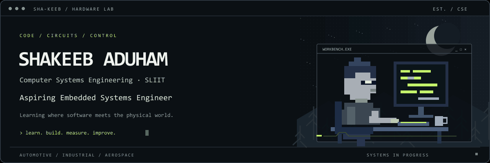

### Computer Systems Engineering Undergraduate · SLIIT
**Aspiring Embedded Systems Engineer · Sri Lanka**

[Selected work](#selected-work) · [Learning roadmap](#learning-roadmap) · [LinkedIn](https://www.linkedin.com/in/shakeeb-aduham-a26641243) · [Email](mailto:shakeebaduham822@gmail.com)

Code / Circuits / Control

## About

I'm Shakeeb, studying **BSc (Hons) in Computer Systems Engineering at SLIIT**. I’m building my foundation in C programming and hands-on electronics, with a goal of developing embedded systems that connect software to the physical world.

My interests span **automotive electronics, industrial automation, and aerospace embedded systems**—especially microcontrollers, sensors, and control systems.

## Selected work

These projects reflect my current programming foundation. Hardware projects are the next step in my portfolio.

| Project | What I practiced | Stack |
| :--- | :--- | :--- |
| [**Tic-Tac-Toe**](https://github.com/sha-keeb/Tic_Tac_Toe_Game_Changed-) | Structures, arrays, game logic, configurable boards, and file logging | C |
| [**Student Management**](https://github.com/sha-keeb/SE2012-2026-S2-L02) | Classes, packages, enrollment, searching, sorting, and JavaDoc | Java |
| [**Java Fundamentals**](https://github.com/sha-keeb/SE2012-2025-S2-L01) | Console input, arrays, student marks, and grade calculations | Java |

## At the workbench

| Current foundation | Developing next |
| :--- | :--- |
| Introductory C; Java and SQL coursework | Embedded C/C++ and microcontroller peripherals |
| Experimenting with Arduino, ESP32, sensors, and breadboard circuits | Communication protocols, feedback control, and hardware debugging |
| Basic electronics prototyping, multimeter use, and soldering | Circuit design, PCB design, and real-time programming |

## Learning roadmap

Strengthening C, understanding electronics, and documenting what I build and measure.

**Planned project ideas**

- **ESP32 closed-loop motor controller** — explore PWM, encoder feedback, and PID control.
- **CAN-bus communication demonstrator** — explore messages between microcontroller nodes, sensor data, and fault detection.

These are learning goals and planned experiments; implementations are not yet published.

---

<strong>Learn. Build. Measure. Improve.</strong> 
Working toward a career in embedded systems and hardware engineering.  
<a href="assets/embedded-banner.svg">Static header</a> · <a href="assets/README.md">Artwork & animation</a>

