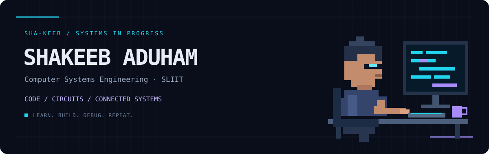

**Computer Systems Engineering Undergraduate · SLIIT**

[C projects](https://github.com/sha-keeb/Tic_Tac_Toe_Game_Changed-) · [Java projects](https://github.com/sha-keeb/SE2012-2026-S2-L02) · [LinkedIn](https://www.linkedin.com/in/shakeeb-aduham-a26641243) · [Email](mailto:shakeebaduham822@gmail.com)

## About

I'm Shakeeb. I’m building my programming foundation through practical **C and Java** projects, with an interest in **embedded systems, IoT, and automation**.

I enjoy understanding how software works close to the hardware, and turning what I learn into clear, well-documented projects.

## Selected work

| Project | Focus | Stack |
| :--- | :--- | :--- |
| [**Tic-Tac-Toe**](https://github.com/sha-keeb/Tic_Tac_Toe_Game_Changed-) | Configurable boards, multiplayer modes, random-move computer opponent, and file logging | C |
| [**Student Management**](https://github.com/sha-keeb/SE2012-2026-S2-L02) | Classes, packages, enrollment, searching, sorting, and JavaDoc | Java |
| [**Java Fundamentals**](https://github.com/sha-keeb/SE2012-2025-S2-L01) | Console input, arrays, student marks, and grade calculations | Java |

## Toolkit

**Building with** · C · Java · Git · GitHub  
**Exploring** · Python · SQL · Spring Boot · REST APIs  
**Hardware interests** · Arduino · Embedded systems · IoT  
**Tools** · MySQL · Postman

## Next up

- Strengthen C programming and problem-solving skills.
- Build documented hardware and software projects.
- Explore how embedded devices connect to backend services.

---

CODE / CIRCUITS / CONNECTED SYSTEMS 
Learning, building, and improving — one project at a time.

