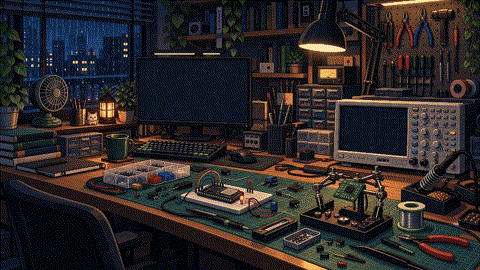
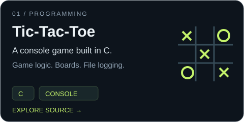
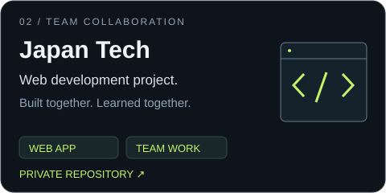
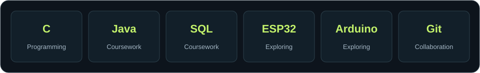
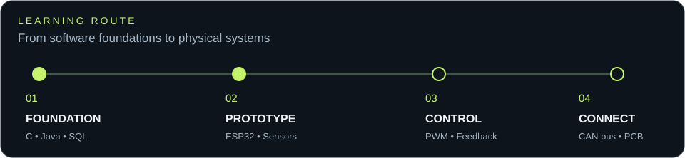

### Computer Systems Engineering Undergraduate · SLIIT
**Aspiring Embedded Systems Engineer · Sri Lanka**

[Projects](PROJECTS.md) · [Toolbox](#toolbox) · [Learning route](#learning-route) · [LinkedIn](https://www.linkedin.com/in/shakeeb-aduham-a26641243) · [Email](mailto:shakeebaduham822@gmail.com)

Learning how software meets the physical world.

## About me

I'm **Shakeeb**, studying **BSc (Hons) in Computer Systems Engineering at SLIIT**. I enjoy C programming, hands-on electronics, and building things I can test and improve.

My direction: **embedded systems, automotive electronics, industrial automation, and aerospace hardware**.

## Featured projects

**[Tic-Tac-Toe · C](https://github.com/sha-keeb/Tic_Tac_Toe_Game_Changed-)** — Configurable boards, multiplayer modes, a random-move computer opponent, and game logging.

**[Japan Tech · Team project](https://github.com/LakithaX/japan-tech)** — A collaborative web development project with Lakitha and the team. **Private repository:** source access is limited to collaborators.

<strong>More coursework & project notes</strong>

- [Student Management · Java](https://github.com/sha-keeb/SE2012-2026-S2-L02) — Classes, packages, enrollment, searching, sorting, and JavaDoc.
- [Java Fundamentals](https://github.com/sha-keeb/SE2012-2025-S2-L01) — Console input, arrays, student marks, and grade calculations.
- [Project directory](PROJECTS.md) — A clear index of my projects, coursework, and planned hardware experiments.

## Toolbox

**On my desk:** breadboards, sensors, jumper wires, a multimeter, and soldering tools.  
**Currently exploring:** microcontrollers and the connection between code and circuits.

## Learning route

**Building now:** programming foundations and electronics experiments.  
**Developing next:** embedded C/C++, peripherals, communication protocols, and hardware debugging.

<strong>Next experiments on the bench</strong>

- **ESP32 closed-loop motor controller** — Explore PWM, encoder feedback, and PID control.
- **CAN-bus demonstrator** — Explore messages between microcontrollers, sensor data, and fault detection.

These are planned learning projects; implementations are not yet published.

 

From the first line of C to the next working circuit. 
<a href="PROJECTS.md">Browse projects</a> · <a href="https://www.linkedin.com/in/shakeeb-aduham-a26641243">Let's connect</a>

